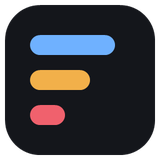
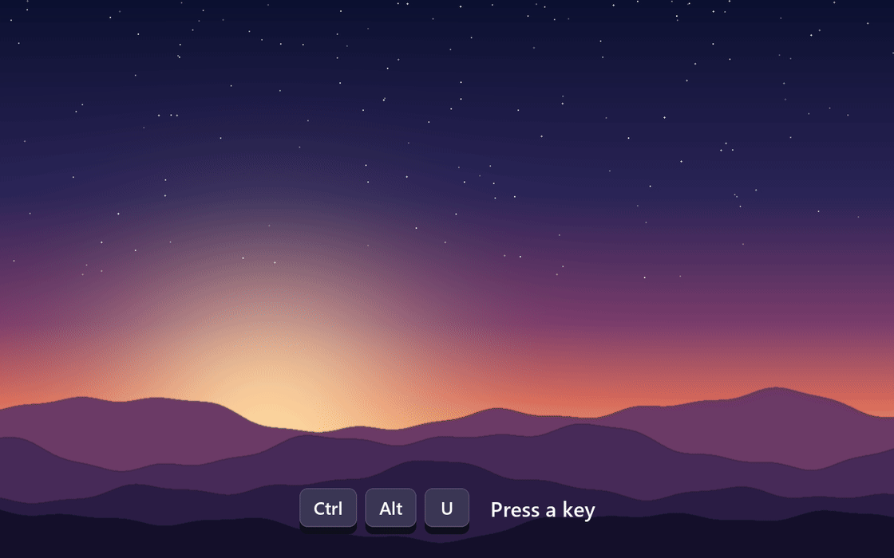
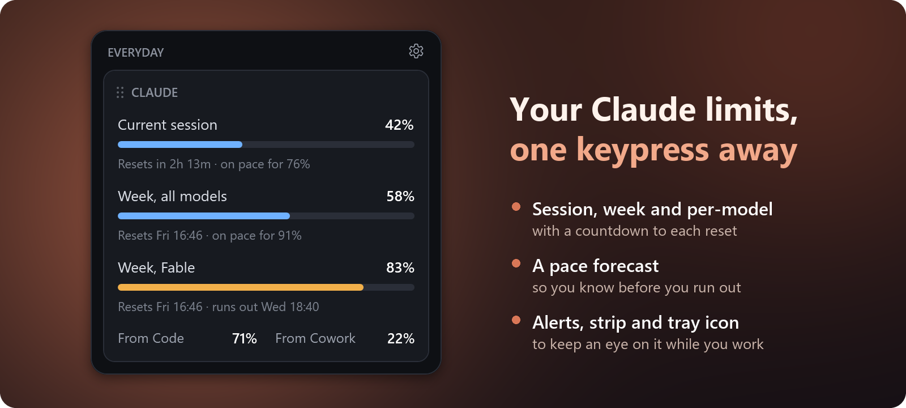
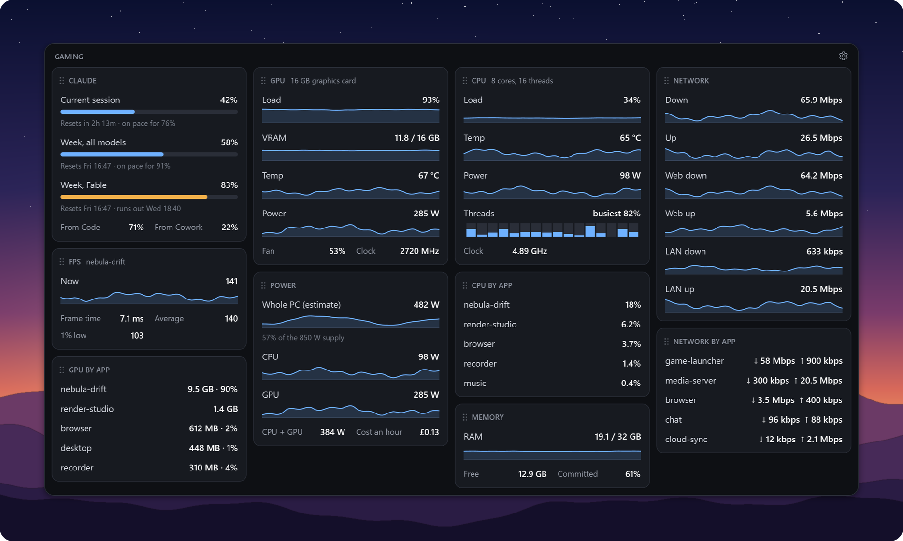
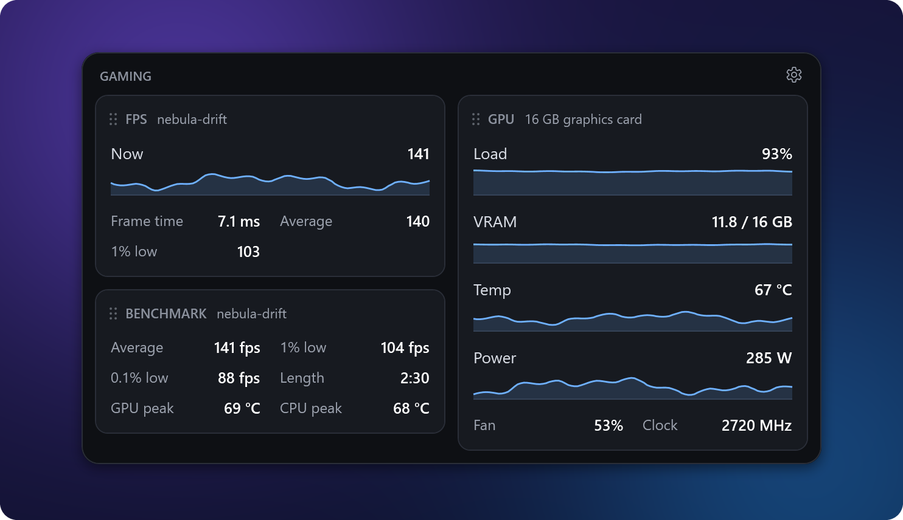
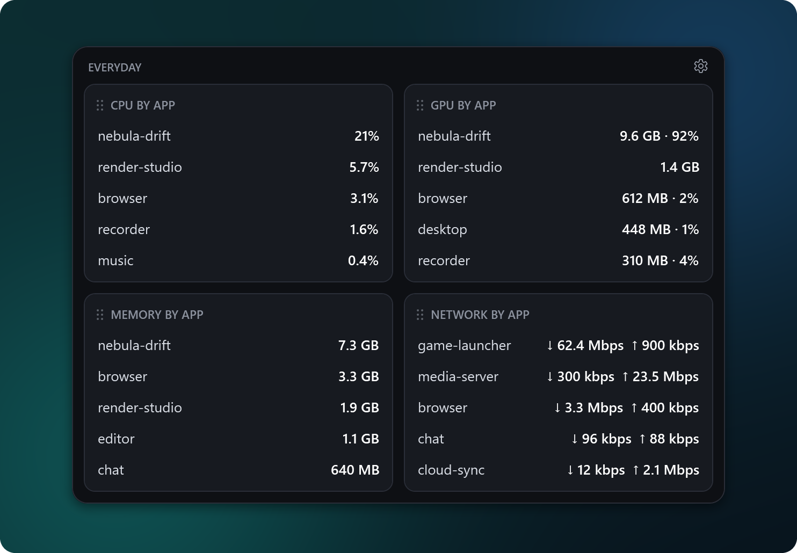
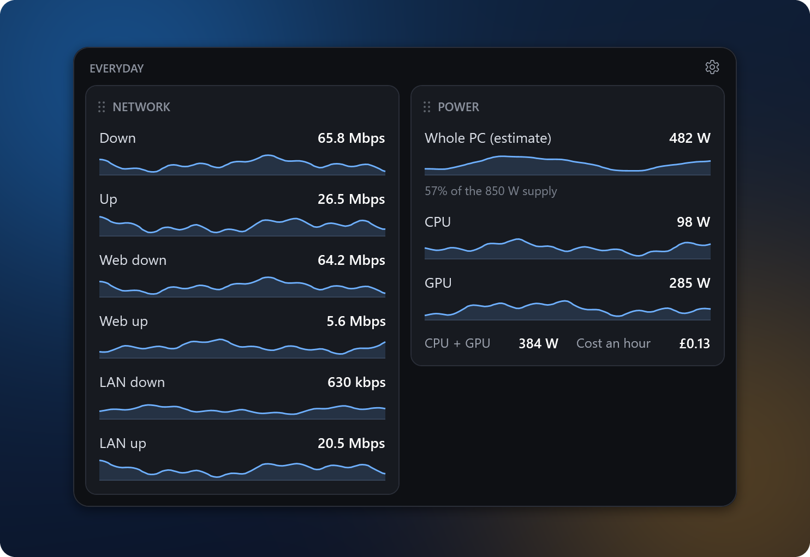
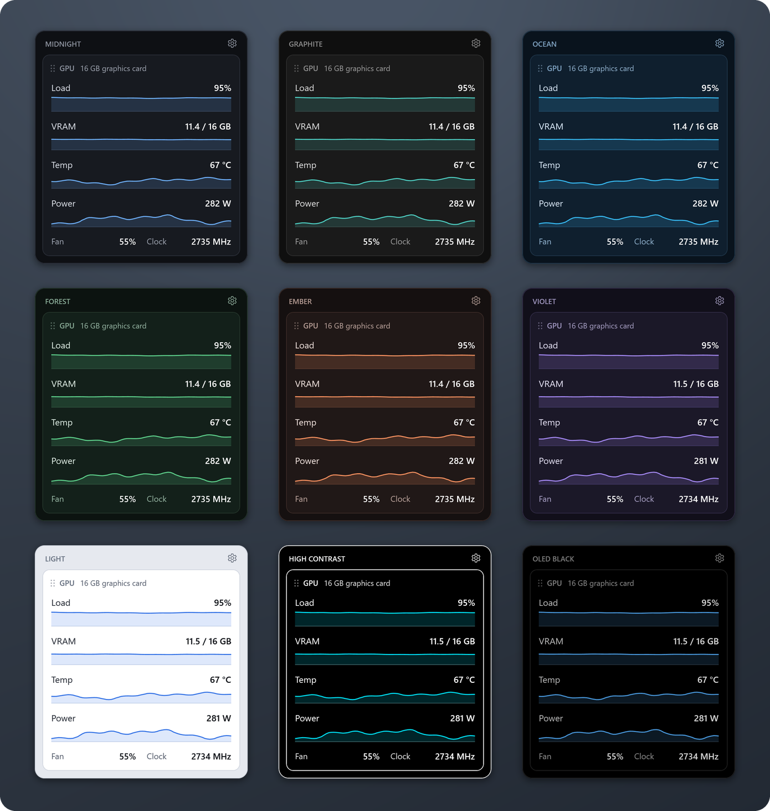
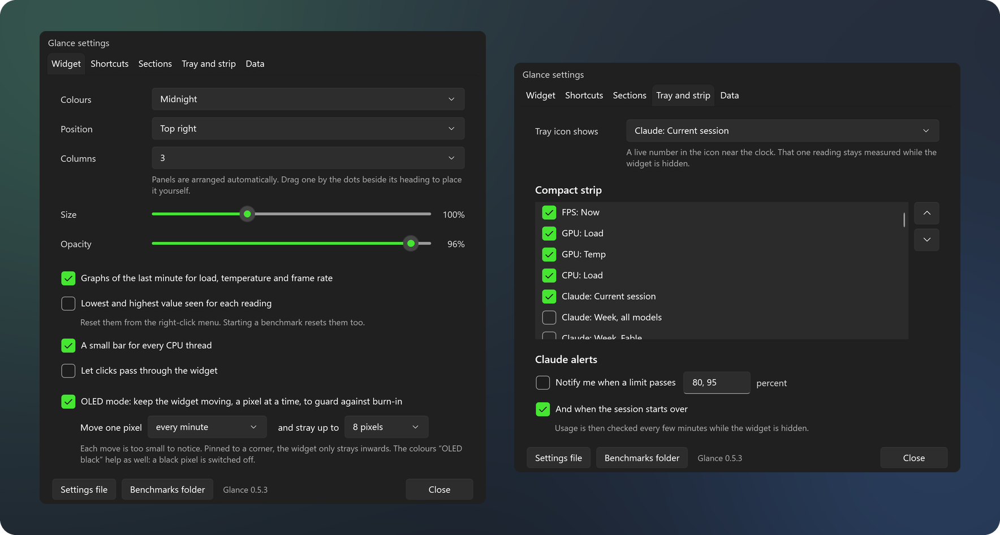
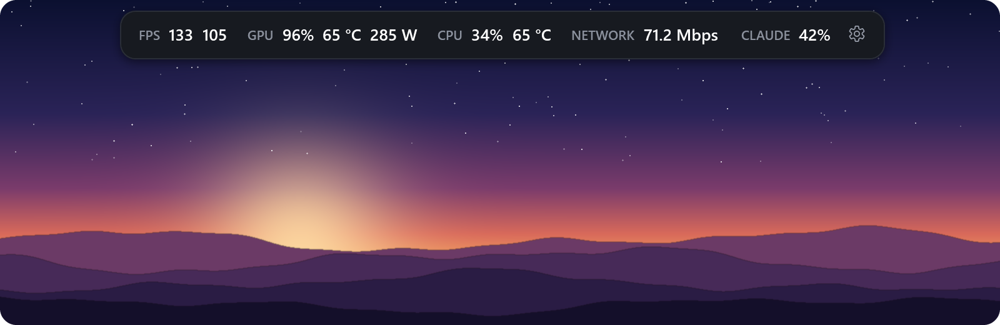

<p align="center"></p>

<h1 align="center">Glance</h1>

<p align="center">
  <b>Press a key to see how much Claude you have left and what your PC is up to.<br>Press it again and it's gone.</b>
</p>

<p align="center">
  
  
  
  
</p>

<p align="center"></p>

You're halfway through a long Claude session and you wonder if you're about to hit the limit. You're in a game and the fans have started to howl. Either way, finding out means leaving what you were doing.

Glance is a small overlay for Windows that stays out of sight until you press **Ctrl+Alt+U**. It appears on top of everything, never takes the keyboard away from what you're using, and has fresh numbers every time. Press again and you're back to work.

## Your Claude usage, always one keypress away



This is the reason Glance exists. It began as a way to stop opening the Claude app just to look at the usage page, and it's still the part we're proudest of.

- **Every limit in one place:** your current session, your week, and weekly limits for single models such as Fable, each counting down to its reset.
- **Will it last?** A forecast tells you where you're heading: "on pace for 76%", or the day and time you'll run out.
- **Where it went:** how much of the week came from Claude Code, Cowork and the rest.
- **A tap on the shoulder:** notifications as you pass 80% and 95% (or whatever you choose), and when a new session starts.
- **In view while you work:** put your session percentage in the one-line strip, or as a live number in the icon by the clock.
- **Polite:** it never asks more than once every 3 minutes, to stay well clear of rate limits. A refresh button is there when you can't wait.

All you need is Claude Code signed in on the same PC. There's nothing to set up and no key to paste.

## Then there's everything else



<table>
<tr>
<td width="50%" valign="top">

### Is this game running well?

FPS, frame time, average and 1% low, for Direct3D 9 to 12, OpenGL and Vulkan. Nothing is injected into the game. Hit a shortcut to record a benchmark and get a summary and every frame time as a CSV file afterwards.

</td>
<td width="50%"></td>
</tr>
<tr>
<td width="50%"></td>
<td width="50%" valign="top">

### What's hogging my PC?

The top five programs for processor, memory, graphics card, disk and network. Panels keep their size and the network list is averaged and held, so you can actually read it.

</td>
</tr>
<tr>
<td width="50%" valign="top">

### Who's using my internet, and what's this costing me?

Traffic split into web and local network, and the top five programs for either one or both, without running as administrator. Power draw in watts for the CPU and graphics card, an estimate for the whole PC, and what it costs an hour to run.

</td>
<td width="50%"></td>
</tr>
</table>

There's also memory, drives, ping, battery, weather, your PC's specs, and any sensor you like from HWiNFO or MSI Afterburner. Turn on what you want and leave out the rest.

## Make it yours



- **Nine colour schemes**, from Midnight to High contrast.
- **Drag panels** wherever you like. Each profile remembers its own layout.
- **Profiles** for work and play. Glance can switch by itself when a game goes full screen.
- **Settings you can see and click**, with changes showing up as you make them.



**Just want one line?** Press **Ctrl+Alt+Shift+U** for the compact strip and pick the readings that go in it.



**Got an OLED screen?** OLED mode nudges the overlay by one pixel at a time, too little to notice, so nothing stays lit in the same spot. The OLED black colours switch the background pixels off altogether.

## Get it

<p><a href="https://github.com/IT8055/widget/releases/latest/download/Glance.exe"></a> <a href="https://walker-jones.eu"></a></p>

One file of about 66 MB for 64-bit Windows 10 and 11, with nothing to install. Put it anywhere and run it. It isn't signed, so Windows asks once: choose **More info**, then **Run anyway**. Settings, About has a button that checks for newer versions.

<details>
<summary><b>Or build it yourself</b></summary>

You need the [.NET 10 SDK](https://dotnet.microsoft.com/download/dotnet/10.0). This makes the same program as the download, in `dist\share`:

```powershell
git clone https://github.com/IT8055/widget.git
cd widget
powershell -ExecutionPolicy Bypass -File .\publish.ps1
.\dist\share\Glance.exe
```

</details>

Curious first? Run it like this to see the overlay with made-up numbers, touching nothing on your PC:

```powershell
.\Glance.exe --demo --show
```

| Press | To |
| --- | --- |
| **Ctrl+Alt+U** | show or hide the overlay |
| **Ctrl+Alt+Shift+U** | show or hide the one-line strip |
| **Ctrl+Alt+Shift+B** | start or stop a benchmark |
| **Ctrl+Alt+Shift+P** | switch profile |

Change any of them in Settings (the gear on the overlay).

## Private by design

There's no account, no telemetry, and nothing phones home. Glance goes online for four things only, and every one of them is up to you:

| What | Goes to | When |
| --- | --- | --- |
| Claude usage | api.anthropic.com | If Claude Code is signed in and you use the Claude panel or alerts. The sign-in is read fresh each time and never stored, logged or sent anywhere else. |
| Weather | open-meteo.com | Only after you pick a town. Rough coordinates, nothing more. |
| Ping | the host you choose | Only while the ping panel is showing. |
| Update check | api.github.com | Only when you press **Check for updates** on the About tab. It asks for the newest version number and sends nothing about you or your PC. |

While the overlay is hidden, nothing is measured except what your tray icon and alerts need.

## Good to know

- **FPS, the web/LAN split and Network by app** need a Windows permission (the Performance Log Users group). If you don't have it, Settings has a button that asks Windows for it.
- **CPU temperature** needs HWiNFO or MSI Afterburner running, because Windows has no way to read it without a driver.
- **NVIDIA cards** show everything. AMD and Intel show load and video memory, plus temperature and power from one of those tools.
- **Games in exclusive full screen** draw over everything, Glance included. Borderless or windowed is fine.
- **It's young.** It has been built and tested on one Windows 11 PC, with an AMD processor and an NVIDIA card. Windows 10, AMD and Intel graphics, laptop batteries, HWiNFO and Vulkan games are catered for but haven't had a proper run yet. If something looks wrong on yours, please [open an issue](https://github.com/IT8055/widget/issues) and attach `%APPDATA%\Glance\glance.log`.

## Want more detail?

- **[The guide](docs/guide.md):** every panel, every setting, and exactly where each number comes from.
- **[For developers](docs/development.md):** how it works, and how to add a panel of your own in about 20 lines.

Made by [Gary Walker-Jones](https://walker-jones.eu). Say hello at [dev@walker-jones.eu](mailto:dev@walker-jones.eu).

---

<sub>The pictures on this page were taken in Glance's demo mode, so every number and program name in them is made up. Glance is an independent project and is not made or endorsed by Anthropic. Claude is a trademark of Anthropic. The usage figures come from the same place as Claude Code's <code>/usage</code> command, which is not a documented service and could change.</sub>
